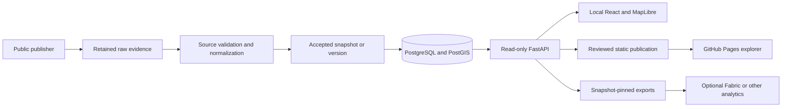

# WaterGeo UK

**[Explore public water data on the map](https://bfawaz2001.github.io/WaterGeo-UK/)**

WaterGeo UK brings public water datasets into a governed geospatial platform for
exploration, reproducible analysis and software development. It retains publisher
identities, source evidence, licensing and time semantics so that a map feature can
be traced back to the accepted data behind it.

**Ingest once, govern once, consume anywhere — including Fabric.**

## Project links

| Resource | Description |
| --- | --- |
| [Public explorer](https://bfawaz2001.github.io/WaterGeo-UK/) | Browse the governed static publication. |
| [System architecture](docs/architecture/system-overview.md) | Understand the local API/database and static-publication paths. |
| [Data portfolio](docs/data-sources/source-portfolio.md) | Review sources, licences, coverage and time semantics. |
| [Evidence and governance](docs/architecture/ingestion-and-evidence.md) | See how retrieval, validation and acceptance remain auditable. |
| [Local demo](docs/guides/local-complete-demo.md) | Run the complete local development stack. |
| [Roadmap](docs/project/roadmap.md) | Review delivered milestones and separately scoped future work. |
| [Presentation walkthrough](docs/guides/presentation-walkthrough.md) | Optional guided product and technical tour. |

## What the platform can do

- **Discover public water data:** search monitoring locations, Water Bodies, bathing
  waters and dated water-supply areas across ten governed source families.
- **Explore maps and detail:** use React, TypeScript and MapLibre for bounded nearby
  queries, publisher geometry, filters and feature provenance.
- **Inspect observations and metadata:** keep measurements, units, periods and
  publisher time separate from WaterGeo retrieval and publication time.
- **Reproduce ingestion:** retain checksummed evidence, validate source-specific
  contracts and accept snapshots atomically into PostgreSQL/PostGIS.
- **Build on a geospatial API:** query read-only FastAPI routes locally with explicit
  pagination, snapshot selection and fail-closed representation checks.
- **Export reviewed products:** create GeoJSON and optional PMTiles,
  Parquet/GeoParquet outputs, with optional Fabric consumption guidance.

## Current status

| Surface | Status |
| --- | --- |
| Public explorer | Phase 16 complete: a governed ten-source static GitHub Pages publication. It is not a live feed. |
| Local API and database | Implemented; operators can retrieve, validate and accept new publisher snapshots. |
| Hosted public API | No publicly hosted FastAPI/PostgreSQL/PostGIS service. Pages serves files only. |
| Fabric interoperability | Compatibility/export foundations and examples; no Fabric deployment or cloud resource is required. |
| Latest milestone | Phase 18A.1 delivered explorer reliability, clearer company discovery, share-state improvements and updated project guidance. |

Publisher observation/publication time, WaterGeo retrieval time and WaterGeo static
publication time are separate. A fresh retrieval does not prove a fresh observation.

## Data portfolio

| Primary product | Publisher / scope | Semantics and refresh |
| --- | --- | --- |
| Water-supply boundaries | Ofwat / England and Wales | Reviewed April 2024 edition, 1,141 areas; manual release acceptance |
| Hydrology | EA / England | Latest accepted stations, measures and observations; dynamic refresh |
| Catchments and Water Bodies | EA / England | Cycle 3 plan hierarchy and publisher geometry; version review |
| Water Quality sampling points | EA / England | Dynamic metadata; sample observations are a separate bounded product |
| Reservoir levels | Severn Trent via Stream / company | 2025 edition, 14 reservoirs and 728 readings; edition review |
| Discharge monitoring | Thames Water / company | Accepted EDM indications; dynamic refresh, not volume or water quality |
| Rainfall | EA / England | Latest accepted accumulated readings; reduced location precision |
| Flood warnings and areas | EA / England | Accepted warning states and official areas; not an emergency service |
| Bathing waters | EA / England | Designations, annual classification and sample/advice context; seasonal refresh |
| Company performance | Ofwat / England and Wales | Reporting-period measures; reviewed workbook and dictionary |

The [source portfolio](docs/data-sources/source-portfolio.md) is the authoritative
index for endpoints, licences, evidence contracts, geographic gaps and cadence.
Hydrology history and Water Quality observations are bounded on-demand products,
not additional national source families.

## Architecture



Static publication replays governed evidence and consumes snapshot-pinned WaterGeo
API representations. It does not fetch publishers from the browser. Optional PMTiles
are a separate reviewed export, not a replacement for exact selected GeoJSON.
See [system overview](docs/architecture/system-overview.md).

## Data governance and reliability

WaterGeo keeps publisher identity and licence metadata alongside retained response
evidence. SHA-256 checks, bounded retrievals and source-specific schema rules reject
unexpected content before it reaches an accepted snapshot. Database publication is
transactional: a failed refresh leaves the previous accepted snapshot available and
the rejected evidence inspectable. The application API is read-only and multi-page
consumers pin one snapshot to prevent mixed results.

An “accepted” retrieval means that evidence passed WaterGeo's reviewed contract. It
does not certify that a publisher measurement is recent or that a safety condition is
current. Observation time, publisher publication time, WaterGeo retrieval time and
static publication time remain separate. Read [ingestion and evidence](docs/architecture/ingestion-and-evidence.md)
and [data flow and time semantics](docs/architecture/data-flow.md) for the full contract.

## Local development

Prerequisites: Python 3.12+, [uv](https://docs.astral.sh/uv/getting-started/installation/),
a running Docker engine with Compose, and Node 24.15+ within Node 24.
Run from the repository root:

```bash
uv sync --locked
test -f .env || cp .env.example .env
```

**Before continuing:** edit `.env` and replace all four password placeholders with
separate strong values (long alphanumeric values avoid dotenv quoting problems).
There are no usable default passwords. Never commit `.env`. Existing volumes retain
their database roles/passwords: follow the [volume instructions](docs/guides/local-platform-reference.md#existing-database-volumes)
instead of assuming an environment edit rotates credentials.

```bash
docker compose up --build --wait db
uv run --locked alembic upgrade head
uv run --locked watergeo-demo-bootstrap --dry-run
uv run --locked watergeo-demo-bootstrap
```

The legacy bootstrap loads **six core source families** and may fetch missing
publisher evidence. It is distinct from the **ten-source static publication**.
Use `--offline` when replaying retained evidence without network retrieval.
Current schema readiness is `0012`. Start the API in one terminal:

```bash
uv run --locked uvicorn watergeo.api.app:create_app --factory --reload --no-access-log --no-proxy-headers
```

Start the explorer in another terminal:

```bash
cd web
npm ci
npm run dev
```

Vite proxies the local API on `127.0.0.1:8000`. Open the Vite URL printed in the terminal;
OpenAPI is at <http://127.0.0.1:8000/docs>. From the repository root, explicitly refresh
the six dynamic products if desired, then smoke-test the running API:

```bash
uv run --locked watergeo-demo-refresh-dynamic
uv run --locked watergeo-demo-smoke http://127.0.0.1:8000 --complete
```

Refresh uses publisher networks and may take time. See the [local demo guide](docs/guides/local-complete-demo.md),
[full setup/API reference](docs/guides/local-platform-reference.md), and
[SDK/CLI quickstart](docs/guides/developer-quickstart.md).

## Refreshing and publishing

Local refresh accepts new database snapshots; failed validation preserves the previous
accepted snapshot. Six opt-in GitHub refresh workflows require a reachable database,
verified TLS and durable private evidence storage. Their schedules do not prove jobs
are enabled or succeeding. The gated daily static preview replays accepted evidence;
**public Pages deployment is separately and manually triggered**. Refreshing your
local database does not update the public site.

Read [refresh and publication](docs/guides/refresh-and-publication.md) for the current
operator path and the explicitly future automation design.

## Documentation

| Need | Start here |
| --- | --- |
| Understand the platform | [System](docs/architecture/system-overview.md), [data flow](docs/architecture/data-flow.md), [evidence](docs/architecture/ingestion-and-evidence.md) |
| Understand the data | [Data model](docs/architecture/data-model.md), [geospatial model](docs/architecture/geospatial-model.md), [source portfolio](docs/data-sources/source-portfolio.md) |
| Use the explorer | [Data interpretation](docs/guides/explorer-data-interpretation.md), [navigation and basemap](docs/design/explorer-navigation.md) |
| Operate or publish | [Source operations](docs/guides/source-operations.md), [static publication](docs/deployment/zero-cost-static-preview.md), [production operations](docs/guides/production-operations.md) |
| Export or integrate | [GeoJSON/PMTiles/GeoParquet](docs/guides/phase-8-exports.md), [Fabric compatibility](docs/guides/fabric-compatibility.md) |
| Develop and validate | [Contribution guide](CONTRIBUTING.md), [checks](docs/guides/local-platform-reference.md#checks), [security](SECURITY.md) |
| Review decisions | [ADRs](docs/adr/), [development history](docs/project/development-history.md), [roadmap](docs/project/roadmap.md) |

## Independence, licensing and limitations

WaterGeo UK is a personal, independent open-source project. It is not an Ofwat product
and is not affiliated with, endorsed by or maintained by Ofwat, the Environment Agency,
Stream or any water company. Views and design decisions are the maintainer's own.
Internal employer data, systems, credentials, code and unpublished material must never
be used. Only appropriately licensed public/open data may be integrated.

The [MIT licence](LICENSE) covers WaterGeo source code, **not third-party datasets**.
Each source retains its own terms and attribution; new integrations require a licence
assessment. The water-supply source does not identify its OGL edition: this remains
unknown, not silently assumed to be OGL 3.0.

Bounded nearby clusters are not national totals. Dated boundaries do not establish a
property's current supplier. Monitor indications do not establish pollution volume,
supply risk or bathing safety. For flood safety use the official EA service, not this
snapshot explorer. Source-specific caveats remain attached to detail and provenance.
The explorer filters bathing-water classifications within the loaded nearest results,
not across an implied national inventory. Rainfall and Hydrology details retain each
publisher-declared measurement period and separate observation from retrieval time.

## Current limitations and next steps

- Nearby point results are bounded nearest results, not national totals or complete
  feature distributions. A reviewed national point overview is Phase 18C work.
- Rainfall uses the previous accepted snapshot after a publisher response supplied a
  non-scalar reading on 11 October 2026; validation correctly rejected that refresh.
- Water-company search groups returned exact areas but does not claim a complete
  company boundary inventory or current property-supplier result.
- The public site is an immutable static edition. Historical rainfall and richer
  Hydrology/Water Quality analytics are Phase 18B work.
- The public deployment has no FastAPI/PostGIS service. API hosting, access policy,
  monitoring and budget need a separate production review.

## Development history

Delivered capabilities and phase references are recorded in the
[development history](docs/project/development-history.md). Planned hosting security,
publication automation and analytics work are separated in the [roadmap](docs/project/roadmap.md).
