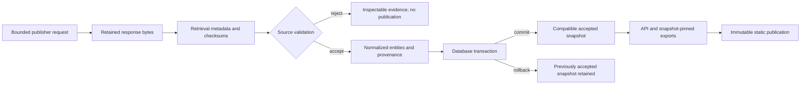

# Data flow and time semantics

This is the conceptual lifecycle, not a promise that every legacy client stores
identical filenames or retains every failed network response. Source readers enforce
their own completeness, bounds and checksum contracts before loaders may publish.
Thames explicitly separates raw retrieval evidence from a validated manifest; national
products normalize verified raw bundles. See [evidence](ingestion-and-evidence.md).

## Identity and acceptance

Publisher identifiers remain source identifiers, including opaque Water Quality IDs.
A snapshot or retrieval ID identifies the accepted scope. Normalization/presentation
versions and hashes are part of compatibility, not cosmetic metadata. A dataset is
unavailable when there is no compatible accepted snapshot; infrastructure failures
are errors, not proof that nothing was loaded. Loading retries verify stored content.
Multi-page consumers pin one snapshot and reject changes or non-advancing cursors.
Independent Thames map-near requests can observe newer accepted snapshots; selecting
an entity and iterating/exporting data must preserve the selected snapshot.

## Which clock?

| Time / identity | Meaning | Does not imply |
| --- | --- | --- |
| Publisher observation | When a reading/sample was measured, where supplied | WaterGeo observed or verified the event |
| Publisher publication/update | When the source says an entry changed | Every value was measured then |
| Retrieval start/completion | When WaterGeo obtained the bounded evidence | Publisher readings are current |
| Snapshot / retrieval identity | Accepted evidence, content and scope | A globally atomic publisher dataset |
| Static publication time | When WaterGeo generated the immutable browser bundle | New publisher retrieval |
| Pages deployment time | When that bundle was deployed | New measurements or a live feed |

Hydrology separates newest observation age from retrieval age. Thames preserves
publisher times without inventing offsets. Water Quality observation timestamps can
remain text when timezone semantics are unspecified. Versioned reservoir readings
remain a dated edition. Missing times remain missing.

The source-status panel reports explicit retrieval policy, unavailable policy state
or a version/edition. Static retrieval age progresses beyond build time; it does not
turn a static publication into an updating service. Publisher safety or water-quality
judgements are never inferred from retrieval freshness.

## Static publication boundary

The governed private package is validated, replayed into disposable PostGIS, and read
through the API after migrations. Publication produces a manifest, publication report,
source-status and search index alongside data assets. Frontend build, public-artifact
guards and browser acceptance precede protected deployment. Raw evidence and private
release credentials must never appear in Pages artifacts.
Local refresh, gated preview and public deployment are three separate actions; see
[refresh and publication](../guides/refresh-and-publication.md).
