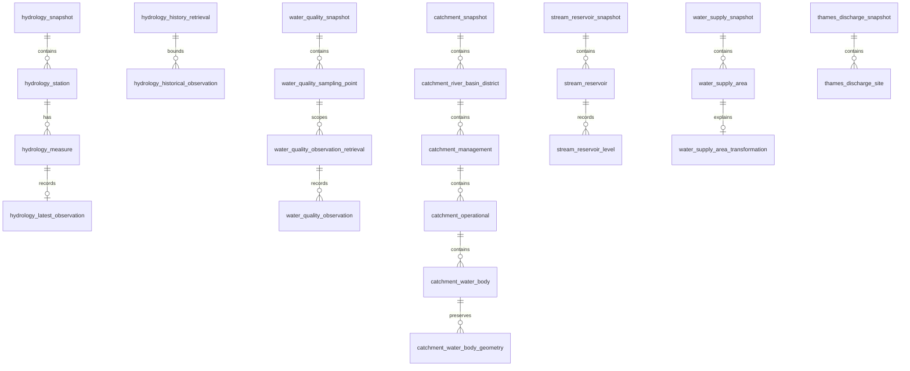
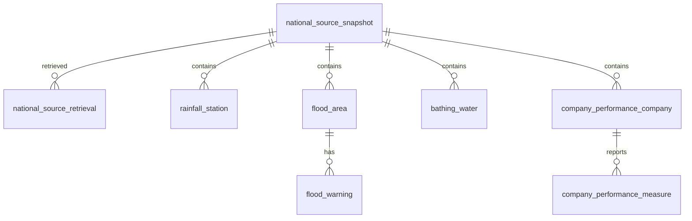

# Data model

Current schema readiness is **Alembic `0012`**. The authoritative schema is the SQL in
[migrations](../../migrations/versions/), under schema `watergeo`. Explicit migrations,
not ORM inference, define the physical keys, constraints, geography indexes and grants.
Historical ADRs may correctly reference earlier revisions.

## Snapshot families

Relationships shown are physical snapshot-scoped relationships, not spatial
associations. Entity keys include the snapshot ID and publisher identity; child foreign
keys retain that scope. No station-to-catchment or property-to-current-supplier join
is invented from geographic overlap.

| Family | Representative keys and semantics |
| --- | --- |
| Hydrology | `(snapshot_id, station_id)` → measures identified by `measure_id` → latest observations; explicit history retrievals preserve measure/time scope separately |
| Water Quality | `(snapshot_id, sampling_point_id)` metadata; observation retrieval IDs reference the point snapshot and carry scoped results, determinands/units, qualifiers and sample relationships |
| Catchments | Publisher RBD → management → operational → Water Body identities within one plan snapshot; geometry rows preserve separate publisher features |
| Reservoirs | `(snapshot_id, reservoir_id)` plus dated reading rows; units and publisher timestamps stay unconverted |
| Water supply | `(snapshot_id, source_id)` area geometry plus transformation records; source, canonical and presentation provenance stay distinct |
| Thames | Snapshot-scoped monitor identity and indication fields, not inferred pollution or safety events |

## National source envelope

`national_source_snapshot` identifies a `source_key`, content SHA, normalized SHA,
normalization version, counts and manifest. Uniqueness includes source, content hash
and normalization version. `national_source_retrieval` records retrieval evidence
separately, so another retrieval need not invent a different content product.

- `rainfall_station`: snapshot/station key, nullable WGS84 point, measure/period/unit
  and latest accepted accumulated value; publisher precision restrictions remain.
- `flood_area`: snapshot/area key, valid Polygon/MultiPolygon and centroid,
  source geometry and transformation provenance. `flood_warning` references an area
  and retains warning identity, severity 1–4 and publisher timestamps.
- `bathing_water`: snapshot/location key, annual classification and sample/risk context
  remain separate fields rather than a WaterGeo safety score.
- `company_performance_company`: snapshot/company key. Measures use
  `(snapshot_id, company_id, reporting_period, measure_code)` and preserve the edition
  dictionary. `value_state` distinguishes `reported`, `missing`, `not_applicable`;
  a numeric value is present only for a reported measure. Missing is not zero.

## Representations are not interchangeable

| Representation | Boundary |
| --- | --- |
| Database | Typed constrained entities, geometries and immutable snapshot scope |
| Public API | Bounded/paginated models with provenance and generic failures; compatible accepted snapshots only |
| Static browser bundle | Immutable manifest/report/search index and selected JSON/GeoJSON products; intentionally does not implement every API operation |
| Analytical export | Per-format schema, geometry/CRS, source and snapshot manifest/checksums; optional dependencies |

The static manifest is a publication artifact, not another relational foreign-key
schema. Compatibility depends on versions/hashes as well as a row's existence.
The water-company index is likewise a representation derived from exact
`source_fields->>'Acronym'` values in one accepted boundary snapshot; it is not a new
company table or an inferred spatial relationship. Publisher name variants remain
visible. Company-performance rows remain in their separate national-source snapshot.
See [data flow](data-flow.md), [geospatial model](geospatial-model.md) and
[export contracts](../guides/phase-8-exports.md).
