# Geospatial model and boundary lineage

## Coordinates and queries

GeoJSON uses **longitude, latitude** in WGS84 (EPSG:4326). Water-supply canonical
polygons are stored in British National Grid (EPSG:27700); map output is a separate
presentation. Other products retain validated publisher WGS84 points/features or
explicit source-specific coordinate conversion. Missing locations remain missing,
not invented centroids for every source. Thames grid references and rainfall's reduced
location precision retain their publisher caveats.

PostGIS `geometry` preserves typed coordinates/topology. Nearby point queries use
`geography` distance in metres with spatial indexes, ordered by distance and identity.
Water-supply lookup uses `ST_Covers`, including shared boundaries and overlapping
areas; holes do not cover their interior. Spatial coincidence does not create an
asserted relationship between datasets.

## Reviewed Ofwat water-supply lineage

```mermaid
flowchart LR
  Z[Exact reviewed publisher ZIP] --> R[Strict raw geometry validation]
  R --> C[Five eligible source-specific canonical corrections]
  C --> B[1141 canonical EPSG 27700 areas]
  B --> W[Reproject to EPSG 4326]
  W --> P[Four eligible presentation-only corrections]
  P --> H[Final validity and reviewed hash checks]
  H --> G[Exact API and static GeoJSON]
  G --> T[Optional simplified PMTiles derivative]
```

The reviewed April 2024 archive has five canonical source corrections: IDs **1, 4, 6,
28, 30**. Eligibility is bound to the exact source archive, geometry and reviewed
runtime/method, not arbitrary invalid polygons. [ADR 0004](../adr/0004-ofwat-v1_5-canonical-transformation.md)
records the original canonical decision. There are **1,141 canonical areas**.

Reprojection can introduce self-intersections even when the canonical geometry is
valid. Only IDs **3, 4, 16, 21** receive the separately reviewed WGS84 structure repair,
with `keepcollapsed=false`. Current presentation policy **v3** requires the reviewed
canonical geometry and one of the exact approved runtime output fingerprints, plus
final output validity. All other IDs use ordinary reprojection. Unknown outputs fail
closed; there is no generic repair/densification fallback. Canonical EPSG:27700 rows
remain unchanged. [ADR 0006](../adr/0006-water-supply-wgs84-presentation.md) is the
historical decision; current implementation and cross-platform evidence live in
`src/watergeo/db/water_supply.py` and the source assessment files.

The API feature's publisher `source_id` and `snapshot_id` connect selected map geometry
to provenance. Canonical transformation and presentation version are separate metadata.
API output is unsimplified GeoJSON, bounded by its response-size and validity guards;
projection accuracy depends on runtime/grid resources, not a legal precision guarantee.
Dated company boundaries **do not establish the legally definitive current supplier of
a property**. Preserve source notices, attribution and the unspecified OGL edition.

## Other geometry products

- Catchment Water Body features preserve publisher Polygon/MultiPolygon/LineString
  and other accepted geometry features. A `Catchment` polygon and `RiverLine` stay
  separate; the explorer does not invent dissolved parent boundaries or station joins.
- Flood-area repair policy `ea-flood-area-structure-canonical-v2` accepts only polygonal
  valid results of the reviewed structure repair within existing area/Hausdorff limits.
  Repaired results are normalized for deterministic component/ring order and hashed as
  explicit little-endian 2D WKB. Source geometry/WKB provenance remains separate.
  Source-valid geometry is not silently rewritten by that repair policy.
- Point layers retain publisher identity even without usable coordinates. Map counts
  describe spatially displayable loaded results, not the whole source inventory.

## Map and export representations

Point clusters summarize the **returned bounded points**, not national distribution.
Regional navigation is an orientation aid; its rectangles are not source coverage
polygons. Flood state filters use the loaded accepted warning snapshot, with level 4
explicitly “Warning no longer in force”. Neither polygons nor color establish current
risk; use official EA guidance for emergencies.

The optional water-supply PMTiles overview is a simplified presentation derivative.
Range requests avoid repeatedly transferring the ~50.8 MB exact national GeoJSON;
the measured Phase 8 z0–8 archive was ~695 kB (a historical benchmark, not a size SLA).
Selected geometry still uses the reviewed exact API/static GeoJSON. Snapshot filters
prevent rendering the selected area twice over its matching overview.
GeoParquet stores WKB plus declared CRS/geometry metadata; it is not a browser basemap.
See [export guide](../guides/phase-8-exports.md) and [Fabric compatibility](../guides/fabric-compatibility.md).
