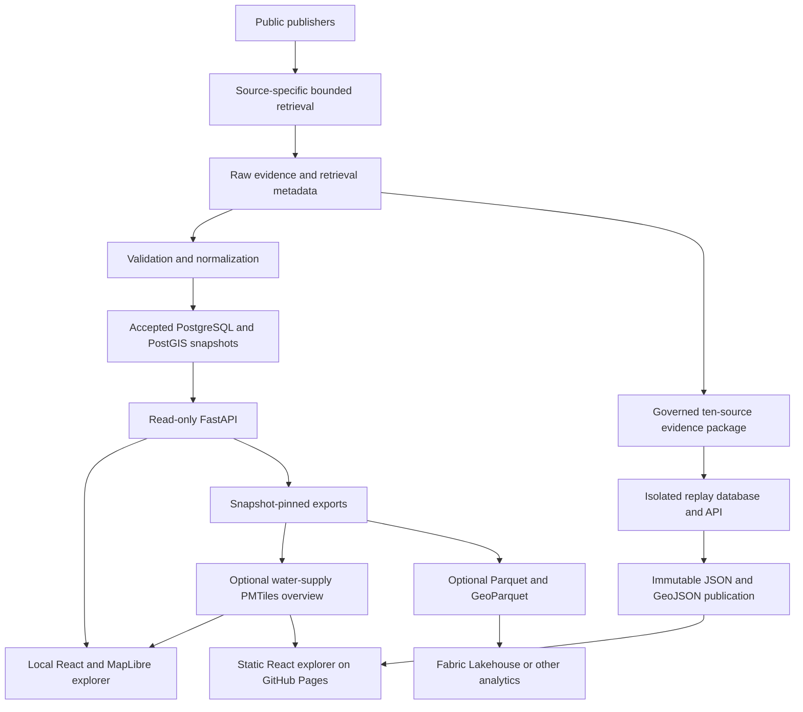

# System overview

WaterGeo is an independent public-data project. Phase 16 delivered the
[public static explorer](https://bfawaz2001.github.io/WaterGeo-UK/).
FastAPI/PostgreSQL/PostGIS run locally or in an operator's environment; they are not
public services hosted by GitHub Pages. Schema readiness is migration `0012`.

The PMTiles arrow denotes an optional separately configured export, not an asset
built by every static publication. Selected water-supply geometry still comes from
the reviewed exact GeoJSON representation. Fabric is a consumer: core ingestion and
API operation do not require Fabric or Arrow dependencies. Install export extras only
when using those formats; see [exports](../guides/phase-8-exports.md).

## Boundaries and implementations

| Component | Responsibility / implementation |
| --- | --- |
| Retrieval | `src/watergeo/ingestion/`: source allowlists, response limits, publisher-specific readers and evidence |
| Operations | `src/watergeo/operations/refresh.py`: cooperative source locks, supervised deadlines, validation and atomic load |
| Database | Explicit SQL migrations; read-only API, separate ingestion and migration credentials |
| API / SDK | `src/watergeo/api/`, `src/watergeo/client/`: bounded reads, snapshot/version contracts and provenance |
| Static publication | `src/watergeo/static_publication.py`: pinned reads, checksummed products and immutable manifest/report |
| Evidence handoff | `operations/static_evidence*.py`: governed archive validation and private draft-release handoff |
| Explorer | `web/src/api.ts` selects API or `staticData.ts`; neither retrieves publisher data directly |
| Analytical export | `src/watergeo/exports.py`: declared formats and per-export provenance |

The same semantic products have different physical loaders: legacy source families
have dedicated snapshot tables; national rainfall/flood/bathing/company products use
a shared snapshot/retrieval envelope and separate entity tables. No universal physical
pipeline, cross-source join or global publisher transaction is implied.

Water-company discovery is derived from the accepted Ofwat boundary edition. The API
publishes a small acronym index, a cursor-paginated area inventory and one bounded
FeatureCollection of the same exact reviewed features. Static publication materializes
the equivalent index and per-company collection from its already verified per-area
GeoJSON. Company-performance data keeps its own snapshot and is selected separately
through the reviewed exact acronym crosswalk.

Continue with [data flow](data-flow.md), [evidence](ingestion-and-evidence.md),
[data model](data-model.md) and [geospatial model](geospatial-model.md).
Historical phase documents and ADRs retain their original decision context.
