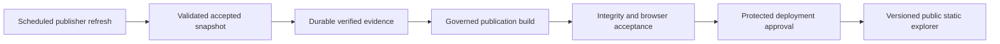

# Refresh and publication

Refreshing a database, building a static preview and deploying Pages are separate
operations. The public explorer is a governed static publication, not a live feed.
There is no hosted public FastAPI/PostGIS service. This guide describes implemented
contracts, not proof that an operator has enabled a schedule.

## Local dynamic refresh

After configuring `.env`, starting PostGIS and migrating to `0012`:

```bash
uv run --locked watergeo-demo-refresh-dynamic
```

The command runs six products sequentially: Hydrology, Water Quality metadata,
Thames discharge status, rainfall, flood monitoring and bathing waters. Each uses
the existing governed source refresh path. A failure is reported per source; later
sources continue unless interrupted. Partial failure returns nonzero and leaves
previously accepted snapshots intact. This command retrieves publisher data.

Individual jobs and offline retries are explicit:

```bash
uv run --locked python scripts/refresh_sources.py hydrology
uv run --locked python scripts/refresh_sources.py flood-monitoring
uv run --locked python scripts/refresh_sources.py hydrology --evidence-dir data/raw/refresh/hydrology/RUN_UUID/BUNDLE_UUID
```

Substitute an actual retained bundle path for the offline example. Missing, partial,
altered or incompatible evidence fails before loading. Retrying identical accepted
evidence verifies stored content. It does not fabricate a new retrieval time.

Jobs use bounded source requests, retained evidence/checksums, source validation,
cooperative database locks and transactional acceptance. The default wall-clock
deadline is 3,600 seconds; source request bounds, pacing and retry limits also apply.
Structured logs report phases and outcomes without exposing raw exception messages
or credentials. Exit codes are 0 success, 1 failure, 2 invalid arguments, 3 lock busy,
4 timeout, 5 interruption. See [source operations](source-operations.md) for recovery,
lock-loss caveats and exact flags. The six-product wrapper returns nonzero for a
partial failure; it does not turn all individual exit codes into separate shell exits.

The legacy [local bootstrap](local-complete-demo.md) covers six core source families.
Those are not the same six as the dynamic refresh command, and neither describes the
ten-source static evidence package.

## Versioned and bounded products

Water-supply boundaries, catchment plans, reservoir editions and company-performance
publications require reviewed version acceptance. Polling more frequently does not
make those dated products current conditions. Hydrology history and Water Quality
observations are separately scoped on-demand retrievals, not scheduled national
archives. See the [source portfolio](../data-sources/source-portfolio.md).

## Implemented refresh schedules

All times below are UTC. Each schedule requires its named repository variable to
equal `true`. Manual dispatch is independent of that schedule gate; original-repository,
main-branch and protected environment checks still apply.

| Workflow | Cron / intended cadence | Enable variable |
| --- | --- | --- |
| Hydrology | `17 * * * *` — hourly at :17 | `WATERGEO_HYDROLOGY_SCHEDULE_ENABLED` |
| Water Quality | `43 2 * * *` — daily 02:43 | `WATERGEO_WATER_QUALITY_SCHEDULE_ENABLED` |
| Thames EDM | `7,22,37,52 * * * *` — four times hourly | `WATERGEO_THAMES_SCHEDULE_ENABLED` |
| Rainfall | `27 * * * *` — hourly at :27 | `WATERGEO_RAINFALL_SCHEDULE_ENABLED` |
| Flood monitoring | `2,17,32,47 * * * *` — four times hourly | `WATERGEO_FLOOD_SCHEDULE_ENABLED` |
| Bathing waters | `31 3 * 5-9 2` — Tuesdays May–September; `31 3 1 1-4,10-12 *` — first of other months, 03:31 | `WATERGEO_BATHING_WATERS_SCHEDULE_ENABLED` |

Production jobs require a reachable external database, verified TLS, protected
credentials and private versioned S3-compatible evidence storage. Missing configuration
fails closed. Start with [scheduled Hydrology](scheduled-hydrology-refresh.md) and
[evidence storage](evidence-storage.md). The workflow definitions do not establish
an operational freshness SLA or demonstrate that any schedule is currently succeeding.

## Static preview and public deployment today

The gated preview (`19 5 * * *`, `WATERGEO_STATIC_PUBLICATION_ENABLED`) replays the
pinned accepted evidence package. It does not fetch fresh publisher data. Governed
archive checks, migrations, ten-source replay, immutable publication, artifact guards
and browser acceptance precede an uploaded preview. The public Pages workflow is
manually dispatched separately. A local refresh does not update either artifact.

For exact release/checksum pins, token scope, environment approvals and launch checks,
use the [static publication runbook](../deployment/zero-cost-static-preview.md).
Publisher observation/update time, WaterGeo retrieval time, publication generation
time and deployment time must remain separately labelled. Retrieval policy measures
WaterGeo retrieval age, not publisher observation freshness.

## Future controlled automation — not implemented here



The components exist individually; unattended end-to-end publication is future work.
Deployment-specific failure alerts, freshness dashboards, publication retention and
rollback policy need operator review. Existing JSON logs and workflow summaries are
not a promise that those monitoring integrations are deployed.
